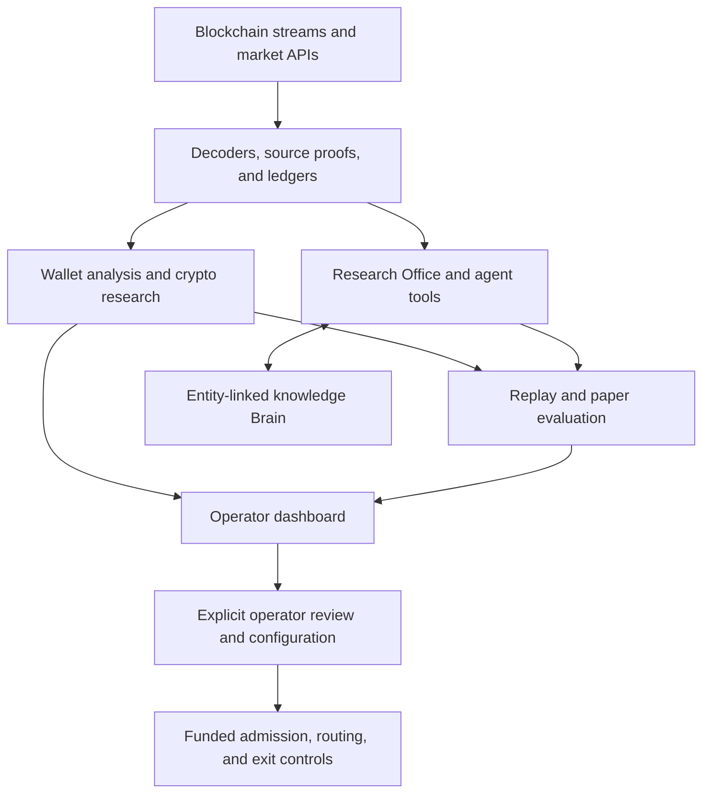

# Architecture tour

Sniper combines a crypto research platform, a multi-agent research Office, and a persistent knowledge Brain. They have different responsibilities: a research observation, a model proposal, a paper result, and authority to execute a funded order are separate things.

## The big picture

This is a responsibility map, not a claim that every experiment is enabled or that the Brain runs synchronously on an order path.

## 1. The research Office

The Office is more than a collection of prompts. Its host runtime owns what an agent may do and records what happened.

| Mechanism | Code |
| --- | --- |
| Durable turns, supervisor leases, and stale-generation fencing | [`supervisor.py`](../sniper/office/supervisor.py) |
| Typed tool requests and results, with coverage and source references | [`broker.py`](../sniper/office/broker.py) |
| Host-owned capabilities | [`capabilities.py`](../sniper/office/capabilities.py) |
| Canonical records, atomic appends, and verifiable record chains | [`store.py`](../sniper/office/store.py) |
| Agent memory and snapshots | [`memory.py`](../sniper/office/memory.py), [`memory_store.py`](../sniper/office/memory_store.py) |
| Paper trials, training records, and promotion machinery | [`v2_paper.py`](../sniper/office/v2_paper.py), [`training.py`](../sniper/office/training.py), [`training_promote.py`](../sniper/office/training_promote.py) |

Private evaluation records are separated from the supervisor's ordinary store. Hash chains support integrity checks, but detecting a removed tail requires an independently trusted chain head. Durable records alone do not prove an agent made a good decision.

The separate [`agents/`](../agents/) package contains wallet scouting, archetype analysis, strategy review, and adversarial review modules. Their presence describes available source code, not a claim that every agent is currently active.

## 2. The knowledge Brain

The Brain is an entity-linked knowledge system, rather than a single growing prompt file.

- **Typed facts and states:** rules, traps, decisions, findings, measurements, tasks, and observations have explicit verification and supersession states. See [`bot/brain_graph/__init__.py`](../bot/brain_graph/__init__.py).
- **Evidence checking:** references to commits, paths, configuration knobs, and schema columns can be checked independently. Missing runtime files remain unchecked when absence cannot prove a broken reference. See [`evidence.py`](../bot/brain_graph/evidence.py).
- **Contradiction candidates:** facts sharing entities and meaningful action keys become review candidates; similarity alone is not proof of contradiction. See [`contradict.py`](../bot/brain_graph/contradict.py).
- **Retrieval:** keyword and optional embedding signals are combined with recency and status filtering. See [`search.py`](../bot/brain_graph/search.py).
- **Persistence boundaries:** unavailable storage, invalid configuration, version conflicts, and refused writes are distinct cases. See [`store.py`](../bot/brain_graph/store.py).
- **Operator and crew interfaces:** [`scripts/brain_cli.py`](../scripts/brain_cli.py), work records, handover inventory, and database migrations expose the machinery for inspection.

The code and schema are public. The running Supabase database, private memories, service credentials, and local snapshots are not included.

## 3. Crypto research beyond a single strategy

| Domain | What to inspect |
| --- | --- |
| Solana and EVM launch networks | Funding relationships, wallet rotation, launch identity, receipt verification, campaign history, and token flows in [`sniper/office/`](../sniper/office/) |
| Streaming transaction research | Feed adapters in [`sniper/feeds/`](../sniper/feeds/), capture and materialization services in [`sniper/services/`](../sniper/services/) |
| Hyperliquid | Copy decomposition, microstructure, paper evidence, calibration, and research surfaces in [`sniper/hyperlive/`](../sniper/hyperlive/) |
| Short-horizon crypto | [`sniper/algos/btc5m/`](../sniper/algos/btc5m/) and [`sniper/algos/polymarket_crypto5m/`](../sniper/algos/polymarket_crypto5m/) |
| Wallet behavior and reusable theses | [`sniper/analysis/wallet_protocol/`](../sniper/analysis/wallet_protocol/), [`winning_wallet_thesis/`](../sniper/analysis/winning_wallet_thesis/), and [`thesis_cards/`](../sniper/analysis/thesis_cards/) |
| Versioned paper experiments | [`sniper/research/memecoin_strategy/`](../sniper/research/memecoin_strategy/) |

The research challenge is causal: what was actually known before the trade, how complete was the observation, and could the proposed action have executed? Retrospective chart peaks and wallet similarities cannot answer those questions alone.

## 4. Execution and performance engineering

[`sniper/execution/`](../sniper/execution/) contains routing, signing boundaries, submission transport, and recovery components. [`sniper/services/memecoin_real_runner.py`](../sniper/services/memecoin_real_runner.py) coordinates funded decisions with persisted admission and exit state.

Interesting review points include durable close claims, exact transaction identity before broadcast, ambiguous-send recovery, duplicate ownership across feeds, original source-age limits, executable exit checks, and chain-specific routing.

The [`Rust QUIC sidecar`](../rust/solana-tpu-sidecar/) receives already-signed Solana wire bytes from a [`Python client`](../sniper/execution/solana_tpu_sidecar.py). It does not hold a signing key. Here, TPU refers to Solana transaction processing, not an ML accelerator.

Offline timing tools such as [`txshape_latency_bench.py`](../scripts/research/txshape_latency_bench.py) measure frame-level work. Local CPU timing, provider latency, transaction acceptance, and confirmed chain landing are different measurements.

## 5. What this publication proves

It makes the source, architecture, design contracts, and tests inspectable. The public CI verifies a named subset of offline contracts, including Office and Brain behavior. It does not establish complete deployment reproducibility, security, complete on-chain coverage, strategy profitability, or live execution quality.
