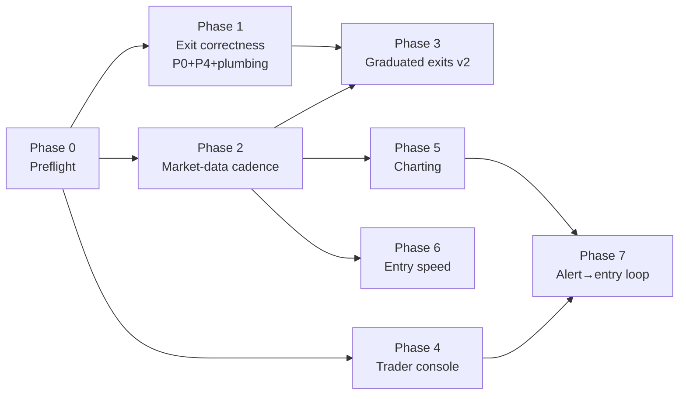

# Memecoin Discovery + Day-Trading Platform — Master Build Prompt

> **For agentic workers:** This is a MASTER prompt spanning multiple subsystems. Execute phases IN ORDER. For each phase: author the per-phase spec with `superpowers:brainstorming`, then the per-phase plan with `superpowers:writing-plans` (checkbox tasks, complete code, verified-red tests), then implement with `superpowers:test-driven-development` or the `/ship` pipeline. Do not skip a phase's acceptance gate. Do not start a later phase while an earlier phase's gate is unmet, except where the dependency map marks phases parallel-safe.

**Goal:** Upgrade the memecoin subsystem from a copy-trading research stack into a discovery + day-trading platform: sub-minute market data, graduated exits, a trader console with per-position actions, real charting, faster entries, and a closed alert→entry loop — without ever violating the funded-contract regime or the pre-registered read discipline.

**Architecture:** The funded runner (`scripts/memecoin_runner_loop.py` → `sniper/services/memecoin_runner.py` + `memecoin_real_runner.py`) stays the single money-mutating process, release-pinned at `.runtime/memecoin/current`. All improvements land as: (a) data-plane upgrades feeding the existing sweep (`memecoin_exits.py`), (b) policy changes shipped only through frozen-contract cohort cutovers, (c) read-only UI/API surfaces in `sniper/routes/api_memecoin.py` + `static/app.js`, and (d) operator-triggered actions that reuse the funded entry/exit machinery.

**Tech Stack:** Python 3.13, SQLite WAL (`sniper_tracker.db`), Flask blueprints, vanilla JS (`static/app.js`), Solana RPC + EVM JSON-RPC, GeckoTerminal REST (rate-capped), DexScreener, Telegram, pytest.

## Global Constraints (every phase, every task, every subagent)

1. **REAL MONEY.** The funded runner is live. Never launch it from the checkout; cron/manual recovery invokes `.runtime/memecoin/current/scripts/memecoin_watchdog.sh`. Deploys ONLY via `scripts/deploy_memecoin_runtime.sh <full-sha>` — sha reachable from `origin/main`, clean tree, fresh SQLite backup, zero pending reservations, funded-contract reconciliation, positive terminal-exit config gate.
2. **Sealed-read discipline.** `scripts/memecoin_postcutover_exit_read.py` gates at n≥30 (29/30 at authoring). The operator-authorized n=29 look lives in `docs/superpowers/specs/2026-07-22-memecoin-stop-derisk-redesign-proposal.md`; its registered branch did NOT fire. Any new confirmation read must be pre-registered as a fresh spec (cohort, metrics, n-gate, actions) BEFORE data accrues. Never peek, never move exit knobs outside Phase 1/3's operator-approved path.
3. **Funded contract regime** (`docs/superpowers/specs/2026-07-18-memecoin-funded-entry-contract-regime-design.md`): every reservation at/after `MEMECOIN_FUNDED_CONTRACT_MIN_RESERVED_AT` carries one canonical immutable contract (attempt+pending+position bytes/hashes match). Live-row mismatch bricks armed startup; terminal-row mismatch pages as audit debt; deploy validator strict on both. Policy changes NEVER mutate existing frozen contracts — new cohort cutover only, via the `--activate-rollover`-style atomic mechanism in `docs/superpowers/specs/2026-07-18-memecoin-exact-balance-rollover-design.md`. Never hand-write a future cutoff while the old runner is live.
4. **Market regime is risk-only** (scale clips down, never veto/increase). **post_peak labels need a fresh exact whole-balance route quote before any signing/broadcast mutation.** Concurrency + total exposure are global across funded chains; balances/gas are chain-local.
5. **Clock trap.** Host clock is ~7h FAST. DB timestamps are corrected-UTC (offset in `data/clock_offset.json`). Never compare DB stamps to host `date`/file mtimes; verify liveness against server `Date` headers or the heartbeat file.
6. **Schema discipline.** `python3 scripts/brain_index.py schema <table>` before naming ANY column; `python3 scripts/validate_schema_refs.py` before every commit that names columns; `python3 scripts/brain_index.py generate` after schema changes (CI fails on stale index).
7. **Paper/real separation.** Paper arms and research writes never mutate real rails. `execution_mode='real'` rows are written only by the funded path. Blind-chain probe HTTP and candidate research writes stay AFTER the current poll's funded hooks (`docs/superpowers/specs/2026-07-16-memecoin-capture-coverage-design.md`).
8. **GT rate limits are load-bearing:** 15s min-interval, shared 429 cooldown, 300s TTL (`docs/superpowers/specs/2026-07-16-memecoin-gt-429-hardening-design.md`). New data consumers must not add GT calls to the entry/exit hot path.
9. **4663 execution doctrine** (`docs/superpowers/specs/2026-07-16-memecoin-direct-swap-4663-design.md`): funded entries + pre-entry safety on verified V3; V2 Router02 fallback is exit-only, exact-balance, fee-on-transfer-aware, fail-closed.
10. **Fomo follow invariants** (`docs/superpowers/specs/2026-07-16-memecoin-armed-fomo-follow-design.md`): follow before approval persist; repair in sync; never unfollow on disarm; never revoke because Fomo is down.
11. **Parallel-work guardrails:** foreign WIP → `wip/foreign-<date>-<topic>` branch, never stash; honor clean-tree preflight; no main-worktree git ops while a /ship pipeline runs.
12. **Honesty rules:** quote actual command output; distinguish observed from assumed; a deploy is not "live" until the runner restarted AND the heartbeat verified (`data/memecoin_runner.heartbeat` ts age <30s, `auth_ok: true`).
13. **Knowledge Sync Gate** at every branch close (PR template's 11-question Knowledge Delta Report; "Delta: none" must be attested).
14. **No new real-money risk without an operator checkpoint.** Building + testing is autonomous; ARMING anything that changes what real dollars do (exit knobs, new order types live, clip/chain exposure, auto-entries) stops at the checkpoints below.

## Operator approval checkpoints

| # | Phase | What needs an explicit "approved" |
|---|---|---|
| A | 1 | Deploying P0 (route nano/micro/mid stops through `real_stop_pct_for_chain`) to the funded runner via cohort cutover |
| B | 3 | Activating graduated-exit policy v2 (partial derisk / trail-arm changes) for new cohorts |
| C | 4 | Enabling live partial-sell / per-position action buttons against real positions |
| D | 6 | Switching the funded entry path to any faster submission tier |
| E | 7 | Enabling one-tap sized entries from alerts (even operator-initiated) |

Everything else — code, tests, paper arms, shadow measurement, UI read-surfaces, docs — proceeds autonomously.

## Phase map



Parallel-safe: Phase 2, Phase 4, Phase 5 may run concurrently with Phase 1 (different files). Phase 3 hard-requires Phases 1+2 shipped. Phases 6 and 7 last — they multiply whatever edge exists, so they come after exits stop leaking.

---

## Phase 0 — Preflight & truth check (run at the start of EVERY working session)

**Files:** none created.

- [ ] `cat ~/.claude/projects/-home-bigpapi-Desktop-Sniper/memory/HANDOFF.md` — ground truth beats any summary.
- [ ] `git status --short && git log --oneline -5` — park foreign WIP per Global Constraint 11 (the four `sniper_tracker.db.bak-*` untracked backups are expected; leave them).
- [ ] Runner health: `ps aux | grep "[m]emecoin_runner_loop"` AND `cat data/memecoin_runner.heartbeat` (corrected-UTC ts age <30s, `auth_ok` true). If dead: the watchdog cron recovers it; investigate the runner log, do NOT hand-launch from the checkout.
- [ ] Read gate: `python3 scripts/memecoin_postcutover_exit_read.py` — if it prints the sealed metrics (gate fired at n≥30), STOP feature work, deliver the read + pre-registered actions to the operator before continuing.
- [ ] `python3 scripts/brain_health.py` and `python3 bot/supabase_helper.py semantic "<this session's task>"` — prior findings often answer or refute.

**Gate:** all checks green or explicitly reported. Never proceed on an unexplained red.

---

## Phase 1 — Exit correctness package (build now; deploy at Checkpoint A)

**Why:** The n=29 look (proposal spec, commits `ee35b093`/`003132bb`/`dcce0f8d`) found stop-class exits are 81.1% of gross losses, and the 4663 subgroups read +$69.24 (no effective normal stop, n=5, 0 stops) vs −$241.35 (stop=60, n=13, 10 stops), with one operator-override stop (9380, −$31.86) sitting between them.

> ⚠️ **This phase was authored against a P0 framing that has since been RETRACTED** (`dcce0f8d`). P0 is **not** a consistency fix. The 4663 band stops are deliberate later policy: 07-12 disabled the chain-default *normal* stop; 07-16 `assign_micro_policy` added a position-scoped −60% stop whose docstring says it covers 4663 micros *"without touching the chain-wide no-stop decision"*; `e58157c9`/`7b222dff` gave nano/mid the same; `fe355969` froze it; `tests/test_memecoin_funded_policy.py:38-42` pins `stop=60.0` chain-independently. Also: "stop disabled" is the *normal* stop only — every contract keeps the −80% catastrophe floor — and the subgroup is not a natural experiment (different mcap bands, different trail activation, different entry selection, n=5). **Task 1.2 below is therefore a decision to request, not a change to implement.**

P4 (position 9003) — **RESOLVED 2026-07-22**, see Task 1.1.

**Read first:** `docs/superpowers/specs/2026-07-22-memecoin-stop-derisk-redesign-proposal.md` (all of it), `docs/superpowers/specs/2026-07-21-memecoin-postcutover-exit-read.md`, `sniper/services/memecoin_funded_policy.py` (band definitions ~line 82), `sniper/settings/memecoin.py:382` (`real_stop_pct_for_chain`), `sniper/services/memecoin_real_runner.py:192` (`alpha_b_real_exit_reason`), `sniper/persistence/db_memecoin.py:3241` (`unverified_derisks`).

### Task 1.1 — P4 forensic: position 9003 unknown-confirm derisk ✅ DONE 2026-07-22
- [x] On-chain check of all three signatures via Solana RPC `getTransaction`. **Verdict: the de-risk NEVER LANDED.** `3HDs2W9…` returns null, and — decisively, independent of RPC retention — the exit tx `1Z3jq4no…` moved the **full entry quantity** (292581.799277 → 0, USDC +$17.299924) while the entry tx `34Kwaya…` had bought exactly that quantity for −$50.00. A 65.053% de-risk cannot have landed.
- [x] Nothing to book. **Realized −$32.70 is correct; the cohort total −$166.65 is NOT understated** and the `real_trail` decomposition is sound.
- [x] Root-cause fix + 4 regression tests (`tests/test_memecoin_derisk_recovery.py`): `unverified_derisks()` no longer filters `is_open=1`; the recovery state machine branches on `is_open` (closed rows settle audit debt, never emit "rail re-armed", and repeated `not_found` alone is decisive since a closed position has no double-sell hazard). 9003's record self-heals on the next deploy — no DB surgery.
- [x] Committed.
- [x] **APPROVED at Checkpoint A and SHIPPED:** trail arming no longer reads the double-sell guard as proof of recovered principal. `derisk_confirmed(pos)` = stamp AND no outstanding `derisk_sig` — the signature is persisted only while unverified and cleared by settle (landed) or clear (proven not landed), so this needs no new plumbing and keeps `effective_trail` pure. Applied to both the frozen-policy and operator-override paths. 5 regression tests in `tests/test_memecoin_real_rails_v2.py`. Ships in a pinned deploy; `derisked_at` alone still blocks a second de-risk.

### Task 1.2 — P0: 4663 normal-stop policy conflict — **BLOCKED on Checkpoint A, do not implement**

Implementing the reroute as originally written would silently reverse the 07-16/07-18 band policy. It is a new operator decision, and if taken it needs a **new funded policy version + cohort + pinned deploy**, never a helper reroute over `funded-*-v1`.

- [x] Conflict documented with chronology, tests, and corrected subgroup data: `docs/superpowers/specs/2026-07-22-memecoin-stop-derisk-redesign-proposal.md` §P0.
- [x] **Checkpoint A DECIDED 2026-07-22: PARK the 4663 stop-policy cutover.** The deliberate
  −60% nano/micro/mid contracts stay unchanged; the n=29 comparison is confounded and does not
  justify removing the stop. The trail-arming fix WAS approved and shipped separately (see 1.1).
- [ ] ~~Present to operator and WAIT.~~ The question is narrow: *should nano/micro/mid keep their band −60% normal stop on 4663, or inherit the chain-default no-stop?* Evidence both ways: the subgroup split favors no-stop; but on 2026-07-19 the operator manually added a −60% floor to a 4663 position **because** the chain had none (`memecoin_position_exit_overrides` id=81), which is revealed preference the other way.
- [ ] If approved: new band policy version (`funded-*-v2`), failing tests first, immutability test that existing frozen contracts are untouched, plus a test that no band can end up with `stop=0 AND catastrophe=0`. Then cohort cutover via the rollover mechanism (atomic, old runner stopped first), deploy via `scripts/deploy_memecoin_runtime.sh <sha>` from origin/main.
- [ ] Bundle the Task 1.1 trail-arming fix (booked proceeds, not `derisked_at`) into the same cutover — it is the other real-exit correctness item waiting on a checkpoint.

### Task 1.3 — Fresh pre-registered read for the post-P0 cohort
- [ ] Author `docs/superpowers/specs/<date>-memecoin-post-p0-exit-read.md` BEFORE the P0 cutover deploys: cohort = real closes with the P0-era contract hash set, gate n≥30, same metric block as the 07-21 read (total/WR/avg/by-exit-reason/drop-top-k/stop-share), pre-registered actions for each branch. Disclose anything already seen.
- [ ] Extend `scripts/memecoin_postcutover_exit_read.py` (or add a sibling script) to read the new cohort with the same refuse-before-gate behavior; wire `scripts/memecoin_exit_read_alert.sh`'s pattern (hourly cron, one-shot sentinel) for it.
- [ ] Commit.

**Phase gate:** 9003 resolved on-chain with ledger corrected; P0 tests green; new read spec sealed; Checkpoint A decision recorded (approved+deployed, or parked with reason).

---

## Phase 2 — Market-data cadence (the #1 measured lever; parallel-safe with Phase 1)

**Why:** 4663 position marks arrive ~56s apart (p50/p90 = 56.0/56.6s measured on position 11984 — 636 marks); Solana sweeps ~15s. Position 11984's only tick ≥+40% was one ~56s sample; the +50 derisk trigger missed by 1.7 points of route impact on that single tick. Corpus study: copy fills <60s from source +$79/78% WR vs >60s −$15. Faster reads = more decision windows, better trail fidelity, faster copies.

**Baseline (record BEFORE building, in the phase spec):**
```sql
-- 4663 mark cadence, last 48h of data. Anchor on MAX(sweep_ts), NOT datetime('now'):
-- sweep_ts is corrected-UTC while the host clock runs ~7h fast (Global Constraint 5).
SELECT chain_id, COUNT(*) n,
       CAST(AVG(gap) AS INT) avg_gap_s
FROM (SELECT chain_id, mint,
             (julianday(sweep_ts) - julianday(LAG(sweep_ts) OVER (PARTITION BY chain_id, mint ORDER BY sweep_ts))) * 86400.0 gap
      FROM memecoin_position_marks
      WHERE sweep_ts > (SELECT datetime(MAX(sweep_ts), '-2 days') FROM memecoin_position_marks))
WHERE gap IS NOT NULL GROUP BY chain_id;
```
Also record p50/p90 per chain (compute in Python; SQLite lacks percentile).

**Design constraints (bring into the brainstorm):**
- 4663 GT dependence is the bottleneck; the direct-swap work already reads V3 pools on-chain for exact quotes. The cadence fix is reading pool state via the chain RPC (`sniper/services/memecoin_evm_price.py`, `memecoin_evm_leg.py` have the plumbing), NOT more GT calls (Global Constraint 8).
- Solana: fast-lane polling for OPEN POSITIONS ONLY (bounded set, ≤`MEMECOIN_MAX_CONCURRENT`=7) — per-position quote refresh decoupled from the full sweep cadence. Any WS/stream source must fail back to the current poll silently.
- Entry-speed changes belong to Phase 6, not here. This phase is exit-side/marks-side only. Preserve `(network_id, mint)` identity everywhere (07-15 keying finding).
- Marks stay honest: `memecoin_position_marks.source`/`quality` must label the new feed distinctly so research can segment old-cadence vs new-cadence eras.

### Tasks
- [ ] 2.1 Brainstorm + spec `docs/superpowers/specs/<date>-memecoin-marks-cadence-v2-design.md` (baseline numbers embedded; target: open-position mark gap p50 ≤20s on 4663, ≤5s staleness on Solana opens; hot path adds zero GT calls; RPC budget stated).
- [ ] 2.2 Plan via `superpowers:writing-plans`, implement via TDD. Expected touch set: `sniper/services/memecoin_evm_price.py` (on-chain pool read fn), `sniper/services/memecoin_runner.py` (fast-lane loop wiring), `sniper/services/memecoin_exits.py` (consume fresher marks — decision logic unchanged), `sniper/persistence/db_memecoin.py` (only if a new write helper is needed), tests mirroring `tests/test_memecoin_exits.py` patterns.
- [ ] 2.3 Shadow-run ≥24h with the funded runner consuming OLD cadence while NEW marks write in parallel (source-labeled). Acceptance: baseline query re-run shows target cadence on the new source; zero GT 429 regressions (`grep -c 429 data/memecoin_runner.log` delta); no funded behavior change.
- [ ] 2.4 Flip the sweep to the new marks (config knob in `sniper/settings/memecoin.py`, default off → on after shadow acceptance). This changes WHEN rails evaluate, not what they say — it is not an exit-knob change, but call it out to the operator anyway before flipping. Deploy via the pinned script.

**Phase gate:** measured p50 gap on 4663 open-position marks ≤20s over a 24h window; Solana open-position quote staleness ≤5s; GT call volume flat; runner heartbeat healthy through 48h.

---

## Phase 3 — Graduated exits v2 (P1/P2; REQUIRES Phase 1 + Phase 2 + Checkpoint B)

**Why:** The rail sweep showed every first-rail level beats the status quo but none makes the cohort positive, and a global knob damages Solana (+20% rail: 4663 +$82.04, Solana −$6.33) — so v2 must be chain-conditioned and partial, not a global TP.

**Inputs:** P1 (partial derisk ~40–50% at ~+20% executable for nano/micro), P2 (if trail arms early, move `trail_arm_pct` AND `trail_requires_derisk` together; the empirically positive combo is the small band's `trail_requires_derisk=false` + `trail_arm_pct=15`), P3 (4663 exposure lever — cheapest first: smaller 4663 clip). Plus whatever the post-P0 read (Task 1.3) says once it fires.

### Tasks
- [ ] 3.1 Wait for the Task 1.3 read to fire (n≥30 post-P0 closes). Its pre-registered branches decide which of P1/P2/P3 to propose. No peeking.
- [ ] 3.2 Brainstorm + spec the v2 policy bands (new `policy_id`s, e.g. `funded-micro-v2`): partial-derisk fraction, chain-conditioned rails, trail pairing per P2. Every number must trace to a read or be explicitly labeled a guess with a pre-registered evaluation.
- [ ] 3.3 Implement in `sniper/services/memecoin_funded_policy.py` + `memecoin_real_runner.py` exit logic, TDD, with paper-arm mirrors so the shadow book accrues the same policy. Frozen-contract rules: v2 applies to NEW cohorts only, cutover via the rollover mechanism, one atomic cutoff.
- [ ] 3.4 **Checkpoint B**, then deploy pinned; seal a v2 read spec (same template) before the cutover.

**Phase gate:** v2 live for new cohorts, old cohorts untouched (reconciliation green), v2 read spec sealed, paper mirror accruing.

---

## Phase 4 — Trader console: order management (parallel-safe; live-arm at Checkpoint C)

**Why:** The cockpit is read-mostly. Day-trading needs act-buttons: sell 25/50/100% now, tighten trail, close at market — reusing the exact-balance exit machinery so manual actions carry the same safety as automatic ones.

**Existing surface:** `POST /api/memecoin/real/buy` (`sniper/routes/api_memecoin.py:1178`) is the pattern — manual actions route through `make_real_buy_fn` context so classification/safety stay engaged. Manual exits exist only as full closes.

### Tasks
- [ ] 4.1 Brainstorm + spec `docs/superpowers/specs/<date>-memecoin-trader-console-design.md`. Must answer: partial-sell mechanics on Solana (fraction of exact balance, reusing derisk sell plumbing) and 4663 (V3 primary, V2 exit-only fallback per Global Constraint 9); how a manual partial interacts with the frozen contract (proposal: manual actions are operator overrides logged to `memecoin_position_exit_overrides` — schema exists, 14 cols — and never mutate the contract); idempotency + double-click guards; audit trail in `memecoin_fills` with a distinct `kind`.
- [ ] 4.2 API: `POST /api/memecoin/real/sell` `{position_id, fraction}` + `POST /api/memecoin/real/trail` `{position_id, trail_pct}` in `sniper/routes/api_memecoin.py`, gated by `SNIPER_API_KEY` like the buy path, refusing when the runner heartbeat is stale (>60s) so orders can't queue against a dead executor. TDD against a fake execution layer.
- [ ] 4.3 UI: per-position action row in the memecoin tab (`static/app.js`, tab wiring near line 9453): Sell 25/50/100, Tighten trail, with confirm-on-click and the API-key header the tab already uses. Verify with the authed Playwright screenshot flow (`$CLAUDE_JOB_DIR/tmp/shot_dash.py` pattern from memory — claude-in-chrome hits a 401).
- [ ] 4.4 Dry-run mode default ON (`MEMECOIN_CONSOLE_ARMED=0` in `sniper/settings/memecoin.py`): buttons return the exact preview (route, expected proceeds, impact) without signing. **Checkpoint C** to arm.

**Phase gate:** dry-run console verified end-to-end via screenshot + preview responses; armed only after Checkpoint C; every armed action lands a `memecoin_fills` row and an override row.

---

## Phase 5 — Charting (parallel-safe, read-only)

**Why:** Sparklines can't support intra-position decisions. `memecoin_position_marks` (chain_id, mint, sweep_ts, mid, executable_exit_value, liquidity, mcap) is already a tape; Phase 2 makes it dense enough for 1m candles.

### Tasks
- [x] 5.1 API (19e50595): `GET /api/memecoin/candles?chain_id=&mint=&interval=60&since=` in `sniper/routes/api_memecoin.py` — bucket marks into OHLC in SQL/Python, overlay series from `memecoin_fills` (entry/derisk/exit markers with kind + price) and the position's rail levels (stop/derisk/trail from its frozen contract JSON). Read-only, no auth beyond the tab's existing key.
- [x] 5.2 Frontend (5d033ceb/41149358/647db827; reachable via Real closed ledger c378c26d): candle canvas in the memecoin tab (vanilla JS, no CDN — repo ships static assets only), with executable-vs-mid as two series (the 1.7pt gap that cost 11984 must be VISIBLE), fills as markers, rails as horizontal lines.
- [x] 5.3 Verified in-app (authed Chromium, clicked 11984's button in the Real closed panel; chart survives 2 poll cycles; header + rails tell the story). Screenshot via authed screenshot on a real closed position (11984 is the canonical test case: chart must show the single +50.5% mid tick, the +48.3% executable peak, and the −60 stop exit).

**Phase gate:** 11984's story is readable from its chart alone; candles render for both chains; page load adds <1 API call per open chart.

---

## Phase 6 — Entry speed (after Phase 2; live-switch at Checkpoint D)

**Why:** Entry path measured ~9.6s end-to-end on the YAMINE trace (quote 3.4s, safety 1.8s, confirm 2.3s). The latency cliff says <60s copies win; the speed roadmap (Jito/Sender→AMM→TPU) already exists with the right discipline: each tier gated on measured fill-delta.

**Doctrine:** `docs/superpowers/specs/2026-07-15-memecoin-entry-speed-coverage-design.md` — preserve `(network_id, mint)` identity + exact-event attribution; optimize only MEASURED stage bottlenecks; pinned canary with ≥20 submitted attempts per active chain before claiming live p50/p95 improvement.

### Tasks
- [ ] 6.1 Baseline from `memecoin_exec_latency` (gate_ms, safety_ms, exec_ms, total_ms, quote_age_ms per network_id, last 14d) — p50/p95 per stage per chain, written into the phase spec. Attack the largest stage first.
- [ ] 6.2 Implement the top bottleneck's fix (likely: parallelize safety checks with quote fetch where neither mutates; cache immutable per-mint safety facts with explicit TTL; pre-warmed connections). No submission-tier change yet.
- [ ] 6.3 Canary per doctrine: ≥20 submitted attempts per active chain on the pinned release; compare stage p50/p95 vs baseline from the same table. Only then claim improvement.
- [ ] 6.4 Submission-tier upgrades (Jito/Sender) are their own spec + **Checkpoint D**.

**Phase gate:** measured total_ms p50 improvement on ≥20 attempts/chain, attribution columns intact, zero safety-gate regressions (same refusal reasons firing in shadow).

---

## Phase 7 — Alert→entry loop closure (last; arm at Checkpoint E)

**Why:** Radar + setups + TG alerts exist but the loop is open — an alert is a dead end unless the operator hand-types a buy. Closing it = alert carries a pre-sized, pre-railed one-tap entry.

### Tasks
- [ ] 7.1 Brainstorm + spec: alert payload gains a signed action token (single-use, TTL ≤120s, position parameters frozen at alert time: mint, network_id, clip from the current sizing rules, policy band). Acting on it calls the EXISTING `/api/memecoin/real/buy` path — full classification/safety/contract machinery, no bypass. Stale/replayed tokens refuse.
- [ ] 7.2 Implement token mint/verify in `sniper/services/memecoin_telegram.py` + a `POST /api/memecoin/real/buy_token` endpoint; TG message gains the deep link. TDD: expiry, replay, parameter-tamper, runner-dead refusal.
- [ ] 7.3 Dry-run first (token resolves to a preview, not a fill). **Checkpoint E** to arm.

**Phase gate:** dry-run round trip alert→tap→preview verified; armed round trip books a normal funded entry with contract + attribution identical to an auto entry.

---

## Phase 8 — Discovery backlog (optional, fits between phases when blocked)

From the 07-19 radar/intel review backlog: wallet copy-PnL weighting in radar ratings, N+1 query fixes in the radar view, auto-triage. Each is its own small spec+plan; none touches money paths. Roster discipline stands: no zero-evidence force-arms; honest αb metric (`alpha_b_copy_stats_all`, keys `n_closes`/`pnl`) is the only arming evidence.

---

## Execution protocol

1. **Session loop:** Phase 0 → pick the earliest incomplete phase whose dependencies are met → per-phase spec (brainstorm) → per-phase plan (writing-plans, saved to `docs/superpowers/plans/`) → TDD implementation in scoped commits → phase gate verification with quoted output → HANDOFF.md "Completed" append → KSG at branch close.
2. **Branching:** one branch per phase (`feat/memecoin-<phase-slug>`); merge to main only with the phase's focused suite green + `validate_schema_refs.py` clean. Full suite (`python3 -m pytest tests/ -q`) before any deploy-bound merge. Known pre-existing failure NOT yours: `tests/test_ui_algo_tabs.py::test_hyperliquid_analyzer_splits_copy_book_tabs_and_cleaner_controls`.
3. **Deploys:** only `scripts/deploy_memecoin_runtime.sh <full-sha>` from origin/main; verify heartbeat after; report the SHA. UI/API-only changes still restart the web server, not the runner.
4. **Reads before verdicts:** never grade a phase's live effect before its pre-registered n-gate. Paper/shadow evidence is labeled as such.
5. **Reporting:** every phase-gate claim quotes the command and output that proves it. If a gate fails, say so and stop the phase — do not reinterpret the gate.
6. **Stop conditions:** sealed read fires → deliver it first. Runner unhealthy → fix ops before features. Operator checkpoint reached → present and wait; work any parallel-safe phase meanwhile.

## Program definition of done

- Phases 1–7 gates all green (Phase 8 optional).
- Funded runner healthy on a pinned release ≥48h after the last deploy; reconciliation green; zero unexplained audit debt.
- Every knob change traceable: proposal spec → operator approval → cohort cutover SHA → sealed read spec → read outcome.
- The dashboard can answer, for any position, in one screen: what happened, what the rails were, what the engine saw (executable vs mid), and what the operator can do next.
