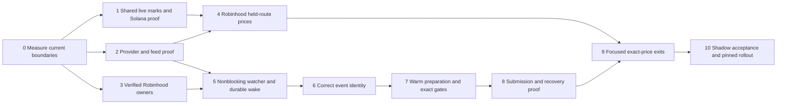

# Robinhood Speed and Shared Subsecond Prices Implementation Plan

> **For agentic workers:** REQUIRED SUB-SKILL: Use superpowers:subagent-driven-development or superpowers:executing-plans to implement this plan task-by-task. Steps use checkbox syntax for tracking. This document authorizes no implementation, deployment or funded action by itself.

**Goal:** Restore proven direct observation on Robinhood 4663, remove avoidable detection/preparation delay, and deliver measured subsecond market prices on both Solana and Robinhood without weakening execution controls.

**Architecture:** Reuse the existing verified-address registry, on-chain detector, shared funded hook, exact route/safety functions, nonce/approval pipeline and same-byte sequencer sender. Add one bounded latest-market-mark snapshot shared by the existing Solana cache and a held-route Robinhood receiver, read by the existing ticker independently of historical tape and exit completion. Use small, separately testable changes; no new trading engine, message broker or database.

**Tech Stack:** Existing Python, SQLite, websockets, HTTP clients, Flask SSE and browser JavaScript; stdlib local Unix datagram wake and atomic JSON publication.

**Spec:** [Current evidence and acceptance contract](/home/bigpapi/Desktop/Sniper/docs/superpowers/specs/2026-09-27-robinhood-speed-and-shared-subsecond-prices.md). Read it before implementation. Existing entry identity, free submission and funded exit contracts remain binding.

## Global constraints

- Robinhood execution scope is chain `4663` only. Shared publication also supports Solana; other chains retain existing behavior.
- No new synchronous network call, disk write or long lock on the Solana entry path.
- Preserve current authority, sizing, age, volume, price ceiling, route safety, loss and exit policies.
- Preserve exact approvals, identity-before-broadcast, same signed bytes, durable reservation/close claims, and signed-unknown recovery.
- Keep spot market mark, full-position executable quote and realized fill price separate.
- Use existing `atomic_write_json`, state paths, decoding helpers and trace JSON. No new production-ledger columns are required for timing or latest marks.
- Quote atomic quantities as integers internally and decimal strings at JSON boundaries where needed; never convert them to JavaScript Number.
- No funded test transaction is required. Observation/shadow and synthetic failure tests precede deployment.
- Robinhood's retired watcher is not reactivated until identity and coverage gates pass; this is a deliberate change to prior operating policy.
- Exact-price subsecond capacity is a separate acceptance gate from the cheap market-price stream. Do not call the latter proof of the former.

## Review focus

1. A router/fee receiver mistaken for a trader must never gain authority — Task 3 receipt/owner fixtures.
2. A healthy-looking socket delivering incomplete logs must degrade coverage and prices — Tasks 2 and 4 gap/reference comparisons.
3. Quote-asset USD is stale while pool state is new — Tasks 1 and 4 reject fresh-USD labeling.
4. Entry confirmation holds a wallet lock while an exit becomes urgent — Task 8 measures contention and preserves ownership; Task 9 tests scheduling.
5. Restart between durable insert and wake, or between signing and response, must neither lose fresh work nor create another order — Tasks 5 and 8 crash fixtures.

## Delivery order and dependencies



Task 1 is the first deliverable: it closes the current Solana price gap without waiting for Robinhood address discovery. Tasks 2 and 3 can proceed independently. A failed capability/identity gate produces explicit unsupported coverage; it is not permission to weaken proof.

Planning estimate, not a promise: about **10–15 engineering days** for the shared publisher, provider proof, bounded observer/handoff, route preparation and integration if existing provider and contract coverage suffice. Address resolution and any dedicated Nitro deployment are externally gated and have no reliable completion date from current evidence. Evaluate progress by acceptance artifacts, not elapsed days.

## Task 0 — Freeze a truthful baseline

**Files:** modify `sniper/services/memecoin_entry_trace.py`, `sniper/services/memecoin_onchain_lane.py`, `sniper/execution/evm_real_seams.py`, `sniper/routes/api_memecoin.py`, `static/app.js` only where missing timing is identified; create `scripts/research/robinhood_speed_report.py` and `tests/test_robinhood_speed_report.py`.

**Owner:** measurement engineer. **Consumes:** existing attempt trace `substage_events`, submission outcomes, observer sequence/block identity. **Produces:** `summarize(rows: list[dict]) -> dict`, a pure report over retained traces; per-event fields remain in existing trace JSON.

- [ ] Add stages for observer arrival, enrichment ready, durable insert, hook start, lock wait, fresh quote/safety completion, approval accept, sign start/end, dispatch, receipt observation and accounting. Use `trace.mark_substage(...)` with monotonic durations. Preserve missing/cross-thread CPU evidence.
- [ ] Write the pure report test first:

```python
from scripts.research.robinhood_speed_report import summarize

def test_missing_source_time_is_not_zero_latency():
    result = summarize([
        {'status': 'filled', 'source_to_fill_ms': None, 'local_total_ms': 600},
        {'status': 'failed', 'source_to_fill_ms': 900, 'local_total_ms': 700},
    ])
    assert result['attempts'] == 2
    assert result['missing_source_latency'] == 1
    assert result['source_latency_samples'] == 1
    assert result['filled'] == 1
```

- [ ] Run `python3 -m pytest tests/test_robinhood_speed_report.py -q`; confirm failure at the missing report behavior.
- [ ] Implement the pure grouping/report function using stdlib, grouping by release, route family, warm/cold, allowance-needed and terminal state. It must not connect to providers when imported. CLI uses `get_readonly_connection()` and bounded indexed queries. Do not sum overlapping stage durations.
- [ ] Add no-lookahead tests: refused/failed/unknown events stay in attempt counts; unknown source slot stays unknown; duplicate observations share one event; a successful zero duration remains valid.
- [ ] Pass the focused test and save an initial report. Commit `feat(research): measure Robinhood stages and missing coverage`.

## Task 1 — Shared latest marks; close the Solana display gap first

**Files:** create `sniper/services/memecoin_live_marks.py`, `tests/test_memecoin_live_marks.py`; modify `sniper/services/memecoin_solana_swap_marks.py`, `scripts/memecoin_runner_loop.py`, `sniper/routes/api_memecoin.py`, `static/app.js`; extend `tests/test_price_freshness.py`. Reuse `sniper/util/atomic.py` unchanged unless profiling proves its off-path fsync is a bottleneck.

**Owner:** price/UI engineer. **Consumes:** current Solana cache callback, bound route identities, independently refreshed quote-USD observations. **Produces:**

```python
# Proposed module contract, not existing API.
class LiveMarks:
    def __init__(self, *, allowed_keys: set[tuple[str, str]], generation: str): ...
    def offer(self, mark: dict) -> bool: ...
    def invalidate(self, chain: str, mint: str, *, reason: str) -> None: ...
    def snapshot(self, *, now_mono: float) -> dict: ...

def read_live_marks(path, *, now_utc: str, max_publish_age_s: float = 1.0) -> dict: ...
```

The method bodies above define an interface; implement them in this task. `mark` contains `chain`, `mint`, `route_id`, `price_usd`, `source`, `source_identity`, `sequence`, `received_mono`, `observed_at`, `quote_observed_at`, `quote_identity`, `quote_sequence`, `commitment`, `healthy`. Envelope contains schema version, generation, publisher time, coverage state and marks. Sequence is ordered within one provider generation; never compare unrelated provider counters as a global sequence. Persist no process-local monotonic value as a reusable clock after restart.

- [ ] Write a failing test that publishes a new price 400 ms after the first and reads the latest value without any historical mark insert. Example input contract:

```python
from sniper.services.memecoin_live_marks import LiveMarks

def test_latest_mark_does_not_wait_for_historical_tape():
    book = LiveMarks(allowed_keys={('solana', 'A')}, generation='test')
    first = dict(chain='solana', mint='A', route_id='curve:A', price_usd=1.0,
                 source='pump_curve', source_identity='slot:10', sequence=1,
                 received_mono=1.0, observed_at='2026-09-27T00:00:01+00:00',
                 quote_observed_at='2026-09-27T00:00:01+00:00',
                 quote_identity='usd:1', quote_sequence=1, commitment='confirmed', healthy=True)
    assert book.offer(first)
    assert book.offer({**first, 'sequence': 2, 'source_identity': 'slot:11',
                       'price_usd': 2.0, 'received_mono': 1.4,
                       'observed_at': '2026-09-27T00:00:01.400000+00:00'})
    assert book.snapshot(now_mono=1.4)['marks']['solana:A']['price_usd'] == 2.0
```

- [ ] Run `python3 -m pytest tests/test_memecoin_live_marks.py -q` and confirm this fails before implementation.
- [ ] Implement validation and a bounded latest-by-key dictionary. Lock only a short in-memory copy/update; no I/O while held. Reject unknown keys, nonfinite/nonpositive prices, rollback of either component sequence within its generation, and wrong route identity. The evidence version is the pair of pool-state and quote-USD identities: a newer conversion with unchanged pool state may update USD, but must not fabricate a new pool trade. Explicit invalidation must reach the consumer even without another trade.
- [ ] Compose the existing Solana `on_mark` callback; do not replace/disconnect the rail-wake callback. Keep worst-move nomination on the existing callback path before display coalescing. Convert to USD using an already available, timestamped conversion; never fetch it inside the callback. Conversion updates also revalue affected cached pool marks without requiring another meme swap. Preserve the old pool observation time beside the new conversion observation time.
- [ ] One background publisher coalesces changes at up to 20 snapshots/s, using `atomic_write_json(state_path('data','memecoin_live_marks.json'), payload)`. Only one writer owns the file. A stalled disk coalesces pending work to the latest snapshot; prices and orders keep running. Publish health while quiet on a separate bounded cadence; do not invent new source observations.
- [ ] Read the snapshot through the existing ticker, outside its SQLite read snapshot where possible. Prefer a matching healthy live mark; retain DB fallback with truthful age/source. Do not overwrite exact executable fields. Add browser render acknowledgements to the research measurement seam, with a bounded ring or file, not synchronous DB writes per frame.
- [ ] Add cases for stale quote/USD leg, generation restart, invalidation without price change, missing/truncated file, delayed fsync, two mints, newer conversion with unchanged pool sequence, quiet healthy coverage, curve completion and rejected wrong-route state. Keep the existing 90-second post-close observation contract but exclude closed positions from funded wake decisions.
- [ ] Run `python3 -m pytest tests/test_memecoin_live_marks.py tests/test_price_freshness.py tests/test_memecoin_solana_curve_marks.py tests/test_memecoin_hot_tp.py -q`.
- [ ] Replay recorded curve and PumpSwap updates through publisher → actual Flask ticker/SSE → browser. Hold a fake exact quote open and prove 400 ms price changes still render. Require p90 ≤750 ms and p99 <1,000 ms at maximum book, with loss/overflow counts. Commit `feat(prices): publish held marks independently of exit sweeps`.

**Solana completion gate:** this task is not complete on unit tests alone. Demonstrate the browser timing and then organic held-position coverage after authorized deployment. Until then report “not yet verified,” including current no-open-book limitation.

## Task 2 — Select a source by delivery evidence

**Files:** extend `scripts/research/robinhood_speed_report.py`; create `tests/test_robinhood_source_coverage.py`; use the existing `sniper/services/memecoin_onchain_push.py` protocol implementation and `sniper/execution/evm_read_rpc.py` endpoint identity checks.

**Owner:** infrastructure engineer. **Consumes:** public/provider read-only logs, receipts and optional raw sequencer feed. **Produces:** a source capability report keyed by endpoint identity, with chain, sequence gaps, reference head lag, event delivery, receipt availability and error classes. Never record credential URLs.

- [ ] Write a failing pure coverage test: headers 100,101,103 cannot report complete coverage; a late 102 can repair a bounded gap only after canonical hash reconciliation. A live ping alone cannot close it.
- [ ] Implement reference comparisons in `summarize`, preserving earliest observed receipt per exact transaction/log and per-source times. Verify `eth_chainId=4663`, block/hash agreement, removed-log handling and subscription acknowledgements.
- [ ] Collect at least a busy 30-minute window and a quiet 30-minute window on existing authorized read-only sources. Enforce explicit request/message caps and stop on quota errors. Compare the same events, not unrelated averages.
- [ ] If provider logs/receipts meet the source budget and coverage gate, select them. If they fail, document the missed budget and provision a supported Nitro node only through a separately approved infrastructure change. Feed it official chain/genesis configuration and Ethereum execution/beacon sources; expose RPC privately. Verify sync and canonical agreement before its data reaches funded decisions.
- [ ] Treat the observed version-1 feed envelope as protocol evidence only. Test signatures, replay and gaps through supported node/client code; do not decode arbitrary calldata and assume execution occurred.
- [ ] Run `python3 -m pytest tests/test_robinhood_source_coverage.py -q`; commit `feat(research): verify Robinhood source delivery and coverage` with measured source selection.

## Task 3 — Resolve actual trading owners before reviving the watcher

**Files:** extend existing `sniper/services/axiom_address_verify.py` and its proof fixtures in `tests/test_onchain_evm_verified_addresses.py`; update read-only coverage reporting. Do not invent a second EVM address registry.

**Owner:** identity engineer. **Consumes:** existing profile/address candidates and exact transaction anchors. **Produces:** current verified identities accepted by `watcher_address_owners(conn)` plus an explicit unresolved roster.

- [ ] Write a failing fixture for the real unsupported purchase shape that blocks a candidate. Use retained receipt/calldata with secrets removed, preserving beneficiary, payer, token, amount, chain and deployed contract identity.
- [ ] Verify several exact buys across distinct mints using the existing proof threshold. A fee receiver, shared router, transfer recipient or common holder is not sufficient. Keep no-data separate from contradictions.
- [ ] Extend only the specific decoder/proof gap demonstrated by receipts. Never promote by removing proof requirements. Bind proof version and contract-code basis; head-only code proof cannot establish historical contract state silently.
- [ ] Add explicit rejection fixtures: another beneficiary; wrong mint/chain; reverted tx; unrelated transfer; shared address; expired proof; revoked arm. Recheck authority immediately before funded admission.
- [ ] Run `python3 -m pytest tests/test_onchain_evm_verified_addresses.py tests/test_memecoin_evm_onchain_watch.py -q`.
- [ ] Publish all 60 currently armed profiles with candidate/proven/failed/missing status and exact evidence links. Initially only proven profiles can enter shadow direct observation. Commit decoder/report changes separately from any registry mutation. Registry proof persistence and watcher revival occur only during authorized rollout.

**Gate:** zero eligible verified owners today means zero direct-copy coverage. Time spent on transport cannot close this gate.

## Task 4 — Held-route Robinhood prices

**Files:** create `sniper/services/memecoin_evm_live_marks.py` and `tests/test_memecoin_evm_live_marks.py`; modify `scripts/memecoin_runner_loop.py`. Reuse `sniper/services/memecoin_evm_v4_events.py`, `sniper/services/memecoin_tick_stream.py`, `sniper/services/memecoin_volume_writer.py` pure decoders/identity rules, and Task 1's publisher.

**Owner:** EVM price engineer. **Consumes:** a bounded immutable map of held/recently closed route bindings plus price-conversion observations. **Produces:** validated `mark` dictionaries accepted by Task 1.

```python
# Proposed pure adapter contract.
def mark_from_state(*, chain: str, binding: dict, event: dict,
                    quote_usd: dict, received_mono: float,
                    observed_at: str) -> dict | None: ...
```

- [ ] Test wrong V4 PoolId/manager rejection before implementation:

```python
from sniper.services.memecoin_evm_live_marks import mark_from_state

def test_wrong_v4_pool_never_prices_a_position():
    binding = {'venue': 'v4', 'manager': 'manager-A', 'pool_id': 'pool-A',
               'mint': 'M', 'base_decimals': 6, 'quote_decimals': 18}
    event = {'manager': 'manager-A', 'pool_id': 'pool-B'}
    assert mark_from_state(chain='4663', binding=binding, event=event,
                           quote_usd={}, received_mono=1.0,
                           observed_at='2026-09-27T00:00:00+00:00') is None
```

- [ ] Run `python3 -m pytest tests/test_memecoin_evm_live_marks.py -q`; confirm the missing adapter fails.
- [ ] Implement correct V2 reserves, V3/V4 sqrt-price orientation/decimal conversion and verified Pons curve semantics. Reuse decoders, not the broad volume writer's blocking loop. Do not present an atomic ratio as USD when decimals are absent. V2 transfer/rebase effects, V4 hooks, transfer tax and multihop state are explicitly covered or marked unsupported; do not infer executable proceeds from spot.
- [ ] Subscribe only to bound routes and their conversion legs. Populate metadata off-thread. Receive callback does decode/validate/local-cache work only; no DB, pruning, backfill or remote reads. Backfill reconstructs state separately and atomically replaces an invalid generation.
- [ ] Reconcile subscriptions on open/close/migration with acknowledgements. On reorg/gap, invalidate affected state immediately. Track all legs of a multi-hop route; a partial route cannot be labeled current USD.
- [ ] Add cases for both orientations and decimals, zero/unknown liquidity, huge atomic amounts, missing quote USD, stale conversion, duplicate/out-of-order/removed logs, route migration, slow metadata and queue overflow. Valid unchanged state must remain distinguishable from broken delivery.
- [ ] Run focused adapter tests plus existing V4/onchain-volume decoder tests selected from the touched functions. Feed output into Task 1 and run the same real-browser timing harness. Commit `feat(prices): stream verified Robinhood held-route marks`.

## Task 5 — Nonblocking wallet observer and durable wake

**Files:** modify `scripts/research/onchain_evm_wallet_watch.py`, `sniper/services/memecoin_onchain_push.py`, `sniper/services/memecoin_onchain_lane.py`, `scripts/memecoin_runner_loop.py`; create `sniper/services/memecoin_onchain_wake.py` and `tests/test_memecoin_onchain_wake.py`; extend existing watcher tests. Add any detection-read helper in `sniper/persistence/db_memecoin.py`, not raw SQL in the new transport.

**Owner:** observation engineer. **Consumes:** eligible owners, provider transfer/log stream, retained canonical receipt decoder. **Produces:** identical durable detections plus a non-authoritative wake; existing `real_hook` remains the only funded admission path.

```python
# Proposed local hint API; payload carries no order authority.
def notify(path: str) -> bool: ...       # AF_UNIX datagram, nonblocking, false on loss
# Runner owns socket lifecycle and uses recv/select with its ordinary poll timeout.
```

- [ ] Add a blocked-enrichment fixture: the first tx/receipt read stalls while a later head and log must still be consumed. Test periodic roster refresh on head-only traffic; empty valid roster revokes subscriptions.
- [ ] Move `push_detection` enrichment to bounded workers, coalesced by chain+transaction. Fetch independent tx/receipt reads concurrently only where the existing RPC budget permits. Resolve decimals, contract proof and quote-asset conversion off the receive callback. One thread owns each SQLite handle; commit is short and occurs after reads.
- [ ] Call `notify` only after committed detection insertion. Path lives under state root, with local restrictive directory/socket permissions. Lost hint is harmless because the cursor is authoritative. Never place wallet keys, signed bytes or order details in the wake.
- [ ] Test durable-insert-then-lost-wake and duplicate wakes. Example pure desired sequence:

```python
def test_lost_wake_does_not_lose_committed_detection(committed_detection, run_poll):
    # Fixture inserts into a temporary ledger without sending any wake.
    seen = run_poll(committed_detection)
    assert seen == [committed_detection['signature']]
    assert run_poll(committed_detection) == []
```

Define these fixtures in the new test file using the existing lane test's temporary ledger and injected hook; no live DB or transport. Include restart with uncommitted insert: nothing becomes visible.

- [ ] Replace unconditional sleep with wake-or-timeout waiting. Retain bounded poll recovery. Isolate the 4663 consumer from long Solana/other-chain hook calls using one chain-scoped cursor/connection and the existing hook—not an additional signer. The ordinary consumer must exclude 4663 when this consumer owns it. Filter in the DB query before pagination; otherwise other-chain rows can starve the bounded page. A lost per-chain wake must still be found by the periodic sweep.
- [ ] Run `python3 -m pytest tests/test_memecoin_onchain_wake.py tests/test_memecoin_evm_onchain_watch.py tests/test_onchain_evm_verified_addresses.py -q` plus touched lane tests.
- [ ] Require warm event arrival-to-hook p90 <200 ms, with receipt-not-ready/cold identity cases separately counted. Commit `perf(onchain): decouple enrichment and wake durable consumers`.

## Task 6 — Fix chain-bound origin parsing

**Files:** modify `sniper/services/memecoin_onchain_lane.py`, `sniper/services/memecoin_volume_writer.py`; create `tests/test_memecoin_evm_origin.py`. Reuse existing origin parsing location; expose one shared pure function rather than another regex copied into a caller.

**Interface:** `source_tx_from_origin(origin: str, *, chain: str, mint: str) -> str | None` validates composite chain/mint and accepts supported legacy bare-hash forms.

- [ ] Write the failing producer-shaped case:

```python
from sniper.services.memecoin_onchain_lane import source_tx_from_origin

def test_composite_robinhood_origin_reaches_tape_identity():
    tx, mint = '0x' + 'a'*64, '0x' + 'b'*40
    origin = f'onchain:4663:{tx}:{mint}'
    assert source_tx_from_origin(origin, chain='4663', mint=mint) == tx
    assert source_tx_from_origin(origin, chain='56', mint=mint) is None
    assert source_tx_from_origin(origin, chain='4663', mint='0x'+'c'*40) is None
```

- [ ] Run test red. Implement validated extraction and call it from volume evidence; preserve current BSC behavior and own-source exclusion.
- [ ] Add integration fixture through `_record` → `OnchainEv` → `gate_evidence`, using in-memory/temp DB and mocked tape reader. Assert the exact source hash reaches the reader and mismatch does not.
- [ ] Pass `python3 -m pytest tests/test_memecoin_evm_origin.py -q` and the current volume-gate tests. Commit `fix(onchain): bind EVM origin parsing to chain and mint`.

## Task 7 — Prepare routes off-path while keeping fresh gates

**Files:** modify `sniper/services/memecoin_evm_key_prewarm.py`, `sniper/execution/evm_real_seams.py`, `sniper/execution/evm_swap_executor.py`, and the relevant immutable-metadata portions of `sniper/execution/evm_token_safety.py`; extend `tests/test_memecoin_evm_review_boundaries.py`, `tests/test_memecoin_evm_seams.py`, `tests/test_memecoin_evm_token_safety.py`.

**Owner:** execution engineer. **Consumes:** verified route keys and metadata, current actual clip, current chain state. **Produces:** existing executable quote/safety contract with added timing, not a new order type.

- [ ] Start from the stored 5.618-second example and measure quote-ladder, safety and market-data waits separately. Establish which calls are repeated immutable discovery versus dynamic execution evidence.
- [ ] Write red tests showing a warm verified route avoids redundant pool-key discovery while still issuing current exact-amount quote and required reverse/safety proof. Change amount/spender/route fingerprint and assert no stale quote reuse.
- [ ] Extend existing prewarm to maintain proven active route keys, token decimals, supported contract identities and warm HTTP connections. Key every item by chain and identity/proof version. Use per-task input values; never mutate process environment, RPC globals or module attributes around a call.
- [ ] Use the prepared route as the first exact candidate. Preserve bounded alternatives when quality/coverage is not established. Reduce the 1.5-second after-hit wait only after retained-event comparison shows equivalent route coverage, executable output and safety decisions. A first-returned dust/decoy route must not win automatically.
- [ ] Keep token safety before first financial mutation. Cache immutable facts with code/proxy identity; never cache “sellable now” as timeless truth. Parallelize independent dynamic reads using existing bounded capacity. Unknown, 429, timeout, revert, malformed and unsupported route remain distinct.
- [ ] Prepared market facts need source/observation times and current quote-asset conversion. No blanket “skip market data” switch. Preserve all current cap/age/volume decisions on replay.
- [ ] Run the three named focused test files. Compare full causal end-to-end traces on shadow organic opportunities; target preparation budget p90 ≤300 ms for the supported warm route cohort. If fresh safety cannot fit, record the unmet constraint rather than bypass it.
- [ ] Commit `perf(evm): reuse verified route preparation with fresh gates`.

## Task 8 — Prove sequencer delivery, nonce and approval recovery

**Files:** modify only demonstrated gaps in `sniper/execution/evm_real_seams.py`, `sniper/execution/evm_fast_submit.py`, `sniper/execution/submission_backends.py`, `sniper/execution/evm_swap_executor.py`, `sniper/execution/evm_exit_executor.py`; tests in existing seams/submission suites and new `tests/test_robinhood_execution_recovery.py`.

**Owner:** execution/recovery engineer. **Consumes/produces:** existing exact signed payload, transaction identity, reservation/claim and nonce. Do not add a new sequencer backend; registry already contains it.

- [ ] Build injected-transports tests for approval accepted, explicitly rejected, ambiguous response, identity mismatch and already-known. Require positive acceptance before signing swap nonce+1; exact allowance stays exact.
- [ ] Verify signed identity is durable before any send. Crash after approval acceptance, after swap signing, after dispatch, and before receipt accounting. Restart must reconcile the same identity; it must not allocate a replacement logical trade because a response was lost.
- [ ] Separate pure signing time from gas/nonce/allowance/preflight preparation. Warm connections and reuse safe request-independent objects; keep live nonce checks/recovery authoritative.
- [ ] Preserve current four-state provider results and same bytes across delivery legs. A matching returned hash is acknowledgement; fill requires receipt and quantity/accounting evidence. Revert releases only the appropriate proven terminal ownership.
- [ ] Measure receipt-observation polling cost; wake the existing receipt reader on a trusted head if useful, preserving request budgets and fallback timeout. Do not confuse faster receipt discovery with earlier execution.
- [ ] Test urgent exit while an entry holds the wallet lock. Keep serialization unless a separate receipt-scoped accounting/nonce design replaces its invariant. If it blocks the required exit SLO, publish that as a blocker; do not unlock the current whole-wallet delta accounting.
- [ ] Run `python3 -m pytest tests/test_robinhood_execution_recovery.py tests/test_memecoin_evm_seams.py tests/test_memecoin_evm_review_boundaries.py -q` plus touched submission tests. No actual transaction send. Commit `test(evm): prove Robinhood fast execution recovery` with only independently necessary code fixes.

## Task 9 — Event-driven exact exit evaluation and quote capacity

**Files:** modify `sniper/services/memecoin_hot_tp.py`, `sniper/services/memecoin_fastlane.py`, `scripts/memecoin_runner_loop.py` and the narrow scheduling seam in `sniper/services/memecoin_real_runner.py`; tests `tests/test_memecoin_hot_tp.py` and new `tests/test_robinhood_quote_capacity.py`.

**Owner:** exit engineer. **Consumes:** Task 4 marks and existing effective rails/close authority. **Produces:** focused exact-quote requests using existing `real_exit_sweep`; market mark never sets executable peak.

- [ ] Add a red fixture: one slow unrelated quote cannot prevent a newly nominated held position from requesting an exact quote. Record global recovery/lock wait explicitly so a fixture does not hide it.
- [ ] Extend source-qualified rail anchors to Robinhood, keyed by chain, position, pool/route and generation. Coalesce duplicate wakeups while preserving worst adverse nomination. Do not compare prices from different sources against one stale anchor.
- [ ] Reuse existing budgeted exact whole-balance preview and durable exit path. Expose quote request/finish and state identity. Missing evidence is unavailable; it never becomes unsellability or a zero price.
- [ ] Move unnecessary global recovery/other-position preparation out of a focused decision where ownership invariants allow it. Preserve non-overlapping decision state and durable close identity; avoid a global quote batch barrier before the first ready decision. If this requires changing wallet accounting, stop that change at the Task 8 design boundary.
- [ ] Test max book plus simultaneous entry, slow RPC, provider budget exhaustion, partial de-risk, manual close, mirror close, trailing peak and an ambiguous send. Confirm exactly one owner submits and no old partial-quantity quote updates a whole-position peak.
- [ ] Measure actual request cost per route and reserve capacity for funded execution. To claim subsecond full-size executable pricing, prove <1-second observation age for at least 99% healthy held-position samples. If budget cannot support it, source/provider capacity is an explicit unmet requirement, not permission to relabel spot as executable.
- [ ] Run `python3 -m pytest tests/test_memecoin_hot_tp.py tests/test_robinhood_quote_capacity.py -q` and the touched exit-claim tests. Commit `perf(exits): focus Robinhood exact-price evaluation on fresh marks`.

## Task 10 — Acceptance, rollout and rollback

**Files:** `scripts/memecoin_watchdog.sh`, `scripts/deploy_memecoin_runtime.sh`, runtime manifest/health surfaces, tests `tests/test_memecoin_watchdog_runner_first.py`, `tests/test_memecoin_deploy_gate_window.py`, and a release-specific audit document.

**Owner:** release engineer. **Consumes:** all earlier passing behavioral and shadow evidence. **Produces:** a deployment verdict with actual process/release, coverage, latency and accounting proof.

- [ ] Verify source/identity gates before reviving 4663 supervision. Launch the existing watcher from the pinned release with explicit `--chain 4663`; exact PID matching must not confuse it with another chain. Default to observation/shadow while coverage is evaluated.
- [ ] Deploy shared prices first. Compare live snapshots against independent canonical state and retained exact quote observations. Show Solana and Robinhood results separately, including conversion freshness and browser paint latency.
- [ ] Run a minimum 24-hour shadow window and retain at least 1,000 supported pool changes per chain and 100 distinct source events where available. These counts are minimum coverage checks, not statistical proof of profitability; absent events mean pending evidence, not failure manufactured by test trades. Include busy, quiet, reconnect and maximum-book synthetic replay results.
- [ ] Acceptance requires price p90 ≤750 ms/p99 <1,000 ms, ≥99% supported event coverage, no identity/duplicate-send failures, and no Solana dispatch regression. List unsupported venues and cold-route delays. Do not silently exclude them from overall service availability.
- [ ] Replay the old and new admission/exit decisions on identical retained events. Only intended timing differences are permitted; unexplained gate/sizing changes block promotion.
- [ ] After applicable operator activation, use the existing pinned deployment and reconciliation gates. Verify SHA, actual PID paths, effective pipeline/submission mode, active verified addresses, acknowledged subscriptions, quote budgets and unresolved ownership.
- [ ] Organic funded events must then demonstrate the warm-entry parity targets. Until there are enough comparable events, report “shadow price gate passed; funded execution parity pending.” A green deploy cannot establish parity.
- [ ] Rollback disables the RH fast consumer/wake scheduling and restores the existing durable poll ownership before restarting. Latest display may fall back to DB with honest age. Preserve all persisted detections, reservation/close identities and signed-unknown recovery. Never replay a signed event as new work during rollback.
- [ ] Commit release documentation with exact measurements and unsupported cases. Report both healthy-window latency and total outage/missing coverage.

## Engineering handoff checklist

The deliverables are complete only when the following artifacts exist:

- [ ] All armed Robinhood profiles have an explicit verified/unresolved status; no implicit on-chain claim for unresolved profiles.
- [ ] Provider capability report proves the selected source and recovery behavior.
- [ ] Shared latest-mark publication passes actual browser replay and organic Solana verification.
- [ ] Robinhood per-venue marks and quote-asset conversions pass identity/freshness tests.
- [ ] Observer enrichment cannot block socket delivery; durable wake cannot lose committed work.
- [ ] Route/safety optimization preserves all gates and typed failures.
- [ ] Approval, nonce, concurrent exit and signed-unknown recovery tests pass.
- [ ] Separate market-price and full-position executable-price SLO reports exist.
- [ ] Actual post-deploy timing demonstrates parity or explicitly names the remaining blocker.

**Present status:** design and plan complete; implementation not started here. Current Solana end-to-end subsecond pricing fails the writer/path check. Current Robinhood direct wallet coverage is zero verified armed addresses. These facts are prerequisites to close, not achievements to assume.
