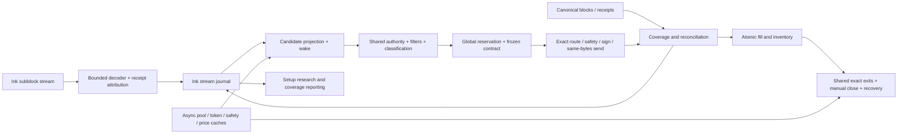

# Ink funded runner — design and release contract

Date: 2026-09-29. Status: engineering handoff; implementation and funded activation have not occurred.
Code baseline: `6f882ffe695394231e32411221ca16c050843921`.

Companion documents: [research](../research/2026-09-29-ink-live-runner-research.md), [complete filter/exit parity matrix](../research/2026-09-29-ink-filter-parity.md), [implementation plan](../plans/2026-09-29-ink-funded-runner.md).

## 1. Decision, scope and alternatives

**Build Ink as another chain context of the existing funded engine, with a dedicated source/state worker.** Reuse custody, admission, atomic reservations, frozen contracts, signing, transport, exact exits, close claims, reconciliation and operator surfaces. Do not fork the runner or replace it with a new strategy platform.

Compared approaches:

- Existing receipt-only EVM watcher: lowest effort, useful canonical fallback; cannot exploit the observed ~200 ms stream.
- **Subblocks adapter + shared funded engine: recommended.** Uses early transactions/receipts while keeping canonical settlement and all existing policy owners.
- Bespoke Rust trader/new smart account: more implementation and custody risk without measured need. Consider only if profiling proves the Python queue/decoder misses targets after bounded work is separated from receive callbacks.

Initial funded candidate authority is the current armed-wallet/manual model, explicitly extended to Ink. Observe launches, pool creation, liquidity, migrations and setup features now; an independent discovery strategy must have its own registered identity and approval path before it can originate funded entries. Never fabricate a followed wallet to bypass that separation. The deliverable must not claim that chain growth or any named setup is profitable.

Initial supported execution universe: certified Uniswap V3, then V4 route classes; certify V2 and Velodrome variants when coverage measurement requires them. Each venue needs entry, whole-balance exit, risk data and recovery support together. Unknown hooks, proprietary launchpad managers and unproven token semantics stay explicitly unsupported. That is honest venue coverage, not a silent filter waiver.

## 2. Edge cases before any implementation

| Class | Required behavior | Explicit limit |
|---|---|---|
| Money path | Every funded path shares authority, risk reservation, contract, signer and exit claims | No funded deployment/arming/key creation authorized by this plan alone |
| Speed | Receive callback decodes/enqueues bounded work; metadata/safety/pool discovery warm asynchronously; reuse mandatory existing execution work | No new blocking lookup/retry/lock justified without measured p50/p90. Targets below are not measurements |
| Concurrency | Immutable chain contexts; one durable nonce owner per chain+custody; bounded queues; per-thread DB handles | No module/env/resolver swapping; no duplicate runner owning the same wallet/nonce |
| Missing/zero | Unavailable price, balance, supply, fee or volume stays typed unknown; measured zero remains zero | No blanket “all unknown fail closed” rewrite of existing selection policy, and no “unsupported means safe” fallback |
| Dependency failure | Timeout, 429, ban, explicit rejection, malformed/partial/wrong-chain/stale replies have separate results | No provider outage becomes token-unsellable or an empty healthy market |
| Units/identity | Raw amounts as integer arithmetic and decimal TEXT; chain 57073; token address+decimals; source/pool/route versions bound | No symbol substitution, cross-chain address guessing, or provisional hash/logIndex fabricated as canonical |
| Sampling | Retain all eligible observations, rejected/missed events and coverage gaps; separate replay from live latency | Accepted trades alone cannot demonstrate setup edge or overall system speed |
| Rollback | Stop Ink entries first, retain exit/recovery capability for existing inventory and unresolved orders | Never roll back to code unable to recover an open Ink position; no DB backup unless requested |

Specific faults to inject: same-slot delayed reads; multi-pool sales; replacement subblock payload; index gaps/duplicates; joining mid-build; null receipt; receipt on wrong block; post-execution/deposit transaction types; failed approval; process death after signing/send; operator disabling mirror during retry; native-fee spikes; USDC/USDC.e confusion; proxy implementation change; tax/rebase/reflection tokens; stream quiet vs stream dead; clock steps and exhausted provider quota.

Not handled by the first release: arbitrary hooks/launchpads, cross-chain entry bridging, flash loans, a generalized account-abstraction/paymaster flow, automatic wallet promotion, automated strategy promotion, or a promise of finality within 200 ms. Unsupported token behaviors receive a terminal coverage reason rather than fabricated prices/fills.

## 3. End-to-end architecture



Use a separate bounded stream/tape database for high-frequency frames and coverage. Only actual normalized candidates and funded lifecycle records enter the main ledger. SQL stays in persistence modules. Existing `db_ticks.py`/volume writer already own canonical tick and gap concepts: extend or reuse those owners, never create two competing canonical frontiers. Observation handles to the main ledger remain read-only; no RPC occurs with a main-ledger write transaction open.

### A. Ingestion and canonicalization

A proposed new `InkSubblockState` decoder consumes raw JSON frames. It emits no complete-build-derived candidate until it has index zero and an uninterrupted sequence. A skipped/duplicated sequence invalidates that connection's reconstruction; byte-identical duplicates from redundant transports can be suppressed before sequencing. Distinct payloads at the same height are competing builds, not additional independent buys. Canonical backfill recovers the gap with source timestamps and preserves unresolved coverage until completion.

The decoder must support typed raw EVM transaction recovery using installed Ethereum libraries. Handle deposit/system transaction types separately; do not treat them as a wallet buy. Bind each metadata receipt map key to the hash of the raw transaction; recover signer/recipient/value/calldata, then verify actual token and quote flows. The live raw logs omit canonical log indexes. Use a receipt-local ordinal for provisional evidence and reconcile it to canonical receipt logs later.

**Proposed event record, not an existing table schema:**

```json
{
  "chain_id": "57073",
  "origin_key": "57073:<tx_hash>:<owner>:<token>:<side>",
  "observation_key": "57073:<payload_id>:<index>:<tx_hash>:<receipt_ordinal>",
  "state": "provisional",
  "payload_id": "<provider payload id>",
  "subblock_index": 0,
  "block_number": 1,
  "canonical_block_hash": null,
  "canonical_log_index": null,
  "token_amount_atomic": "1000000000000000000",
  "quote_amount_atomic": "1000000000000000",
  "source_time_basis": "block_timestamp",
  "source_time_resolution_ms": 1000,
  "received_monotonic_ns": 1,
  "received_utc": "2026-09-29T00:00:00Z",
  "coverage_complete": true
}
```

States: `provisional → canonical_unsafe → safe → finalized`, or `provisional/canonical_unsafe → retracted`. These labels are separate from order states. Multiple observation rows may describe one economic origin; re-emission must still yield at most one reservation. Never persist provisional rows into the current insert-ignore detection shape and assume later canonical corrections will replace them.

Before first funded activation, prove that all pending approvals/orders and acquired inventory survive an observation retraction. If our own transaction is canonically included but its triggering source disappears, retain the position and its approved exit policy; record the invalidated origin. Do not delete exposure or issue an unapproved market unwind. Freeze new Ink admissions on unresolved canonical reconciliation; protective/manual exit and recovery remain available through healthy routes.

Source finality is explicit in the frozen entry evidence. Initial wiring runs with preconfirmed admission off. Enabling it is a separate deployment gate after reorg/recovery tests and forward shadow comparison, not a silent consequence of selecting a faster endpoint. Canonical-only mode remains a slower functional fallback.

### B. State, quotes and simulation

The public stream provides receipts, not a full token-storage snapshot. A subblock-aware RPC/node must prove pending `eth_call`, balance, code and simulation behavior. A current pending response is not automatically bound to the specific observed payload. Record provider identity, read window and available state watermark; prohibit combining stale route state with newer safety state as if they were one snapshot.

Known routes use warmed factory/pool/token metadata and existing exact quoter/safety seams. Use one coherent node/batch/simulation state for dependent reads where supported. If state cannot support a complete provisional proof, wait for canonical state or mark `state_not_ready`; do not remove a filter to reach a timing target. Cold unknown tokens form a separately measured cohort. Required validation remains required even if that means missing the first subblock.

V3 quotes require tick-crossing depth and fee math, not only sqrtPriceX96; V4 requires PoolKey, fee/hook identity and route-specific semantics; Solidly/Slipstream require their own certified math. Exact expected output and signed minimum output remain separate values. Never simulate a sell of our future clip using an arbitrary dust balance.

### C. Risk, filters and adaptation

The companion parity matrix is normative. Every row must have an implementation owner, evidence producer, configured behavior, positive/refusal/unknown fixtures and end-to-end proof. Applicable Solana-only protections must be moved into a shared seam or given an Ink implementation. A mechanism-specific N/A designation never removes its equivalent invariant.

Capability state: `supported_tested`, `policy_disabled`, `unsupported`. Missing capabilities required by the selected contract block **Ink activation**; transient unknowns continue to obey the existing per-gate policy and are audited. A disabled policy feature is not advertised as working. Enabling Ink must not change existing chains' policies.

Mandatory parity gaps to resolve: exact-clip reverse safety allowlist; unknown-age presign recheck; losing/winner reentry parity; cluster evidence where that policy is enabled; source-sale observation and retry disable; turnover/sell-share/LP/volume-death data; market-cap target supply basis; per-chain policy defaults; context validation; on-chain-only market-data readiness without a fictitious DexScreener mapping.

Reuse `EntryClassification` fields for launch/established/revival, momentum, liquidity, regime, band and data quality. A chain-activity monitor can warm capacity and report rising distinct active wallets, qualified launches, credible quote-side depth, executable volume and provider pressure. It cannot arm wallets or increase risk by itself. Regime retains its current shrink-only authority. Candidate policy changes are preregistered and measured on common origins and distinct coins before separate promotion.

GoPlus absence does not erase existing on-chain safety. Reuse the current sell simulation/storage proof first. Enumerate any remaining required facts such as token permissions, holders or clusters and supply them through verified local/provider evidence. Do not add an invented admin-risk veto to other chains; do not claim an opaque contract is safe because a single simulation succeeded.

### D. Execution and accounting

WETH route settlement is the default design; stablecoins remain exact connector identities. Native ETH float and nonce-ordered approval pipelining are optional later optimizations. Default approval behavior is receipt-first unless the specific Ink combination passes the existing pipeline contract and is explicitly activated. Pre-approve only through the existing bounded, operator-authorized lifecycle; do not grant arbitrary routers unlimited access to accelerate a first buy.

Use the existing signer and `auto_free` transport. Chain ID, recipient, router/spender, token, raw amount, value, minOut, deadline and nonce bind to the approved request before signing. Persist signed identity before broadcast; retries use the same bytes. Timeout/429/connection loss is not proof of rejection. Signed or submitted-unknown orders retain reservations until authoritative reconciliation. Fee-bumped replacement, if retained by an existing supported policy, keeps one nonce and linked replacement identities; never creates a second economic order.

Raw quantity math is exact. USD display and policy comparisons use explicitly recorded conversion basis. Entry cost and exit proceeds include applicable L2/L1/operator fees and transfer effects. No whole-block native balance subtraction is attributed to a single trade when another wallet transaction or external transfer shares the block. Prefer transaction-local transfer/trace evidence; when unavailable, keep proceeds unresolved. Never finalize a fill from a provisional receipt or quoted amount.

Within every supported venue, prove buy → owned balance → whole-balance preview → partial derisk → trailing/stop/manual close → canonical proceeds → atomic position finalization. Preserve every executable-trigger audit and distinct healthy-observation debounce. Provider failures cannot ratchet peaks or advance token-unsellable counters.

### E. Operations and deployment

One shared funded process owns the global book; one pinned Ink source worker owns stream ingestion. Worker metadata names code release and independent state root. Reuse per-chain scheduling so Ink backfills/quoting do not monopolize Solana/Base/Robinhood execution resources. Entry-off must not disable funded exits.

Expose Ink authority, custody balances, raw quote asset, source connection/coverage, gaps, provisional vs canonical state, state lag, route coverage, missing capabilities, exact mark age, queue age/drops, quote budget and unresolved orders. Existing API/manual close and leftover-token recovery must really dispatch to Ink; a dropdown or explorer link is insufficient.

Default Ink remains outside the funded allowlist. Startup and deployment must validate **every enabled chain**, not merely that one context built successfully. Rollback keeps additive schema compatibility and retains a compatible Ink exit/recovery process until inventory and unresolved orders are zero. Pinned release deployment uses existing reservation/reconciliation checks and `--defer-backup`; do not use rollover/band activation flags unless that policy change is separately intended.

## 4. Performance and capacity acceptance

These are proposed engineering targets, not measured capabilities. Measure p50/p90/p99 with denominators and confidence/sample counts from the same host and period. Report warm route, cold token, approval-needed, canonical fallback and outage cohorts separately.

| Stage | Proposed healthy warm-path target | Evidence |
|---|---:|---|
| Frame arrival → decode/enqueue | p90 ≤ 10 ms | Recorded stream replay under burst + live shadow |
| Candidate wake → completed local gates/reservation | p90 ≤ 50 ms | Includes durable reservation; no timing outside queue hidden |
| Complete source observation → signed submission acknowledgment | p50 ≤ 150 ms; p90 ≤ 350 ms | Every required check retained; actual RPC/sign/fsync time included |
| Accepted submission → own preconfirmation | Report subblock distance; aim next 1–2 eligible subblocks | Cannot guarantee sequencer ordering or gas capacity |
| Accepted submission → canonical receipt | p90 ≤ 2 s in healthy observed one-second-block regime | Separate from L1 safe/finalized timing |
| Other funded chains | No new synchronous dependency; paired p50/p90 non-inferiority | Compare fixed workload and provider budgets before/after |

If targets miss, report the limiting stage and revise engineering or capacity; never weaken admission to turn metrics green. Canonical fallback is slower and must be labeled. A ~200 ms stream interval is neither event-publication latency nor our fill latency.

Provider budget model: `R_total = R_health + positions × exact_quote_frequency × calls_per_quote + admissions × calls_per_admission + bounded_backfill`. Ten positions at one quote/second and one RPC per quote already mean 864,000 calls/day before admissions. Avoid HTTP polling at stream cadence. Budget from measured route costs, protect exits first, and isolate research/backfill credentials or public capacity. A dedicated node is justified by failed capability/load evidence, not by an assumption that owning hardware speeds up sequencing.

## 5. Release gates

1. **G0 — Verified dependencies:** versioned deployment manifest; chain ID/genesis, token decimals and proxy/code provenance; pending-state/override/receipt/log capability report; unsupported security facts explicitly listed.
2. **G1 — Offline correctness:** all applicable parity rows green; reorg/gap/restart/concurrency/failure fixtures; refusal proves zero approve/sign/send calls; no existing-chain regressions.
3. **G2 — Live observation:** at least 24 hours of shadow including reconnect/restart and a captured burst; compare canonical ground truth across a frozen observation interval, not only admitted trades. Require every gap reconciled or explicitly bounded/censored and no duplicate funded-origin projection.
4. **G3 — Execution rehearsal:** historical/local fork round trips for each certified venue/token class; exact exits and receipt accounting; crash injection at every durable transition. Testnet validates mechanics, not mainnet liquidity/provider latency.
5. **G4 — Operator-approved funded canary:** explicit Ink wallet authority, capped bankroll/clip/exposure chosen by the operator, one route class at a time, healthy exact-exit coverage and tested emergency/manual controls. No global arming. Minimum evidence includes buy and sell, partial exit if enabled, restart with open inventory, and provider failover. Use shadow/fork faults for destructive scenarios.
6. **G5 — Scale coverage:** organic latency/receipt/fill reconciliation and reliability evidence passes; expand venues/wallets/capacity only with the same gates. Profitability/strategy promotion is a separate verdict.

Hard canary stop for new Ink entries: any duplicate economic order, amount/chain/policy mismatch, unresolved accounting inconsistency, broken exit capability, or unsupported required safety. Keep monitoring and compatible recovery/exits alive. Performance misses stop the speed claim and expansion; existing funded policies retain their documented operational handling.
